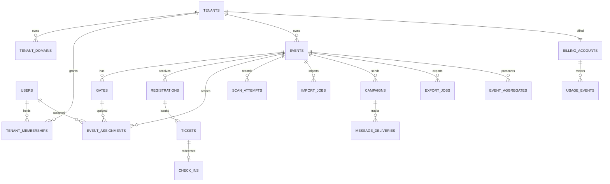

# Event Check-in Platform — Database Design

**Status:** Step 2 proposed logical and physical model  
**Inputs:** [PRD review](PRD_REVIEW.md), decisions D-01–D-13  
**Companion:** [Technical design](TECHNICAL_DESIGN.md)

## 1. Modeling principles

PostgreSQL is the transactional source of truth. A shared database has tenant-scoped rows, composite tenant foreign keys, and row-level security (RLS). The application sets tenant context from a verified domain and authenticated membership for each transaction. The runtime role cannot bypass RLS. Platform control data uses a separate privileged path with audited access.

Each registration belongs to exactly one event. There is no global participant profile at launch: reusing a person's details across events would complicate the approved 90-day deletion rule and is not required by the PRD. The PRD's `Participant` maps to `registrations`. All personal fields live in tables that can be purged by event. Anonymous aggregates live separately and do not retain registration, ticket, message, or staff identifiers.

Types and names below are proposals. `uuid` means a random UUID; timestamps are `timestamptz` stored in UTC; money is integer minor units with currency code; JSONB is limited to versioned form definitions/answers and provider metadata. No production migration is authorized by this document.

## 2. Relationship overview

`SCAN_ATTEMPTS` may refer to a ticket or registration when recognized; invalid attempts have neither. `MESSAGE_DELIVERIES` refers to a registration only until the personal-data purge. `CHECK_INS` is the authoritative per-ticket acceptance record before purge. `EVENT_AGGREGATES` survives purge.

## 3. Core schema

### Platform, tenant, and identity

| Table | Columns (principal fields) | Constraints and lifecycle |
|---|---|---|
| `tenants` | `id uuid PK`, `name text`, `slug citext`, `status enum`, `plan_id uuid?`, `created_at` | Unique slug. Status `provisioning/active/suspended/closed`; exact suspension behavior needs product approval. No participant PII. |
| `tenant_domains` | `id uuid PK`, `tenant_id uuid`, `hostname citext`, `kind enum`, `verification_state enum`, `tls_state enum`, `is_primary bool`, `created_at`, `activated_at` | Global unique normalized hostname; FK tenant; one primary active domain per tenant; inactive/failed hostnames cannot route traffic. Store validation references, not long-lived secrets in plaintext. |
| `tenant_branding` | `tenant_id uuid PK/FK`, `logo_object_key text?`, `primary_color text`, `accent_color text`, `sender_name text`, `sender_domain text?`, `updated_at` | Validate asset type/size and color format; sender-domain verification tracked separately. |
| `users` | `id uuid PK`, `email citext`, `display_name text`, `password_hash text?`, `mfa_state`, `status`, `created_at` | Global identity, unique normalized email; account data follows account retention, distinct from event participant data. Provider-managed identity may replace password hash. |
| `tenant_memberships` | `tenant_id uuid`, `user_id uuid`, `role enum`, `status enum`, `invited_at`, `accepted_at` | PK `(tenant_id,user_id)`; roles at launch `tenant_admin/gate_staff`; platform admin is a separate platform role/grant. |
| `platform_grants` | `user_id uuid`, `role enum`, `granted_by uuid`, `created_at`, `revoked_at` | Privileged access is explicit and audited. No implicit tenant participant browsing. |
| `sessions` | `id uuid PK`, `user_id uuid`, `tenant_id uuid?`, `session_hash bytea`, `expires_at`, `revoked_at`, `last_seen_at` | Store only a hash of opaque cookie secret; host binding and session policy enforced in app. |

### Events and registration

| Table | Columns (principal fields) | Constraints and lifecycle |
|---|---|---|
| `events` | `id uuid PK`, `tenant_id uuid`, `slug citext`, `name text`, `starts_at timestamptz`, `ends_at timestamptz`, `timezone text`, `location text?`, `status enum`, `registration_opens_at`, `registration_closes_at`, `form_schema_version int`, `form_schema jsonb`, `pii_purge_due_at`, `pii_purged_at` | Unique `(tenant_id,slug)`, `ends_at > starts_at`; one check-in session per event. Form schema versioned and validated. `pii_purge_due_at = ends_at + 90 days` per D-11. |
| `gates` | `id uuid PK`, `tenant_id uuid`, `event_id uuid`, `name text`, `status enum`, `created_at` | Unique `(tenant_id,event_id,name)`; gate name is not a free-form person label. |
| `event_assignments` | `tenant_id uuid`, `event_id uuid`, `user_id uuid`, `gate_id uuid?`, `valid_from`, `valid_until`, `revoked_at` | FK to active tenant membership/event/gate; one or more assigned gates only if policy allows. Gate staff scope enforced per request. |
| `registrations` | `id uuid PK`, `tenant_id uuid`, `event_id uuid`, `full_name text`, `email citext NOT NULL`, `phone_e164 text NOT NULL`, `custom_answers jsonb`, `form_schema_version int`, `source enum`, `external_ref text?`, `status enum`, `registered_at`, `deleted_at` | Composite FK to event; unique normalized email and unique E.164 phone **independently per event** for active registrations (D-10); unique `(tenant_id,event_id,external_ref)` when present. Personal data purged at 90 days or admin deletion. |
| `registration_consents` | `id uuid PK`, `tenant_id uuid`, `event_id uuid`, `registration_id uuid`, `purpose enum`, `channel enum?`, `choice bool`, `notice_version text`, `captured_at`, `source enum` | Consent/evidence scoped to a person; purge with registration after 90 days. Legal basis may differ from consent and is configured per purpose. |
| `import_jobs` | `id uuid PK`, `tenant_id uuid`, `event_id uuid`, `created_by uuid`, `source_object_key text`, `status enum`, `total_rows`, `valid_rows`, `error_rows`, `committed_rows`, `created_at`, `completed_at` | Private upload only; state `uploaded/validating/preview_ready/committing/completed/failed`. Source and error files have short retention and are removed by event purge. |
| `import_row_errors` | `tenant_id uuid`, `import_id uuid`, `row_number int`, `code text`, `message text`, `field text?` | PK `(tenant_id,import_id,row_number,code)` or generated ID; do not echo full personal row into errors. Purge with import. |

`registration_source` is `self` or `bulk` initially. The user has approved one session, so no `sessions` or `ticket_classes` domain tables are proposed; the `sessions` table above means authentication sessions only.

### Tickets and check-in

| Table | Columns (principal fields) | Constraints and lifecycle |
|---|---|---|
| `tickets` | `id uuid PK`, `tenant_id uuid`, `event_id uuid`, `registration_id uuid`, `key_version int`, `token_digest bytea`, `token_ciphertext bytea`, `status enum`, `issued_at`, `redeemed_at?`, `revoked_at?` | Composite FK to registration; unique token digest; partial unique index for one `active` ticket per registration. Old revoked tickets may remain until purge. Encryption key is outside database. |
| `check_ins` | `id uuid PK`, `tenant_id uuid`, `event_id uuid`, `registration_id uuid`, `ticket_id uuid`, `gate_id uuid`, `staff_user_id uuid`, `device_id uuid`, `accepted_at timestamptz`, `scan_attempt_id uuid` | Unique `(tenant_id,event_id,registration_id)` and `(tenant_id,ticket_id)` enforce one entry. `accepted_at` is server time. Purge person-linked rows at 90 days after preserving aggregates. |
| `scan_attempts` | `id uuid PK`, `tenant_id uuid`, `event_id uuid`, `ticket_id uuid?`, `gate_id uuid`, `staff_user_id uuid`, `device_id uuid`, `request_key uuid`, `token_fingerprint bytea?`, `result enum`, `received_at timestamptz`, `response_code text` | Unique `(tenant_id,event_id,device_id,request_key)` for idempotency, including invalid attempts. Raw QR never stored. `result` is final online result. Purge person-linkable history at 90 days. |
| `scanner_devices` | `id uuid PK`, `tenant_id uuid`, `event_id uuid`, `user_id uuid`, `label text?`, `last_seen_at`, `revoked_at` | Device ID is for operations/audit, not trust. Personal-device identifiers removed or severed with event data after retention. |

`tickets.registration_id` and `check_ins.registration_id` are kept together to make lifecycle and constraints explicit. Composite FKs must prove all linked records share the same tenant and event; a matching UUID alone is insufficient. The API logs every online scan attempt (F-12), including invalid and duplicate, without storing full presented tokens.

### Messaging, reports, billing, and audit

| Table | Columns (principal fields) | Constraints and lifecycle |
|---|---|---|
| `campaigns` | `id uuid PK`, `tenant_id uuid`, `event_id uuid`, `channel enum`, `purpose enum`, `segment_definition jsonb`, `template_version text`, `status enum`, `created_by uuid`, `recipient_count`, `created_at`, `sent_at` | Admin-confirmed immutable audience snapshot before send; campaign metadata may remain after 90 days only if it cannot identify recipients. |
| `message_deliveries` | `id uuid PK`, `tenant_id uuid`, `event_id uuid`, `campaign_id uuid?`, `registration_id uuid`, `channel enum`, `provider text`, `provider_message_id text?`, `status enum`, `attempt_count`, `last_error_code text?`, `sent_at`, `delivered_at` | Unique provider message ID where present; ticket delivery can have null campaign. Personal delivery history purged at 90 days. |
| `message_suppressions` | `id uuid PK`, `tenant_id uuid`, `contact_hash bytea`, `channel enum`, `reason`, `created_at`, `expires_at?` | May need longer retention for opt-out enforcement; keyed hash and legal basis require explicit privacy approval. Do not silently retain raw contact after event purge. |
| `export_jobs` | `id uuid PK`, `tenant_id uuid`, `event_id uuid`, `requested_by uuid`, `kind enum`, `format enum`, `status enum`, `object_key text?`, `expires_at`, `created_at`, `completed_at` | Private object key, never public `file_url`. Signed download URL is short-lived. Participant-level exports removed at latest by the 90-day purge. |
| `billing_accounts` | `id uuid PK`, `tenant_id uuid UNIQUE`, `paystack_customer_ref text?`, `currency char(3)`, `status enum`, `created_at` | Currency `NGN`; no card data stored. Provider/model approved by D-13. |
| `plans` | `id uuid PK`, `code text UNIQUE`, `paystack_plan_ref text?`, `name`, `terms_version`, `active_from`, `active_to` | Product-owned catalog mapped to Paystack plans; price, interval, entitlement and add-on terms await approval. |
| `subscriptions` | `id uuid PK`, `tenant_id uuid`, `billing_account_id uuid`, `plan_id uuid`, `paystack_subscription_ref text?`, `status enum`, `starts_at`, `ends_at?` | Required launch table under D-13; provider state is reconciled through verified, idempotent webhooks. |
| `usage_events` | `id uuid PK`, `tenant_id uuid`, `event_id uuid?`, `kind enum`, `quantity bigint`, `occurred_at`, `source_id uuid`, `provider_ref text?` | Unique `(tenant_id,kind,source_id)` ensures once-only metering. No participant ID or raw phone/email. |
| `provider_webhook_events` | `id uuid PK`, `provider text`, `external_event_id text`, `received_at`, `processed_at?`, `status`, `payload_digest bytea` | Unique `(provider,external_event_id)`; retain minimum safe metadata; do not keep unbounded full webhook bodies. |
| `audit_events` | `id uuid PK`, `tenant_id uuid?`, `actor_user_id uuid?`, `action text`, `resource_type`, `resource_id uuid?`, `request_id uuid`, `occurred_at`, `metadata jsonb` | Append-only application policy; redact personal values and QR contents. Participant-linked metadata is removed/anonymized by purge. Separate security-retention policy needed for account activity. |
| `outbox_events` | `id uuid PK`, `tenant_id uuid?`, `aggregate_type`, `aggregate_id uuid`, `event_type`, `payload jsonb`, `created_at`, `published_at?`, `attempts int` | Inserted in the same transaction as source data. Payload contains IDs/minimal metadata, not participant PII; short retention after publish. |
| `privacy_jobs` | `id uuid PK`, `tenant_id uuid`, `event_id uuid`, `scope enum`, `requested_by uuid?`, `status enum`, `requested_at`, `completed_at?`, `error_code text?` | Audit of event/person export or deletion. Do not preserve identifiers in job metadata beyond permitted retention. |

### Anonymous aggregates retained after purge

| Table | Columns | Rules |
|---|---|---|
| `event_aggregates` | `tenant_id`, `event_id`, `metric`, `dimension_type`, `dimension_key`, `bucket_start?`, `value bigint`, `finalized_at`, `privacy_version` | No registration/ticket/staff/device/contact IDs. Metrics include registered, checked-in, no-show, duplicate/invalid attempts, and delivery counts. Gate/time cells with low counts should be suppressed or merged under an approved privacy threshold before long-term retention. |
| `event_summary` | `tenant_id`, `event_id`, `registered_count`, `checked_in_count`, `no_show_count`, `duplicate_count`, `invalid_count`, `last_scan_at`, `finalized_at` | One row/event; maintained transactionally or reconciled from detail until finalization. Remains after purge. |

`event_aggregates` can retain gate and time distributions, but very small cells can reveal attendance indirectly. Proposed rule: after purge, retain only aggregate cells that pass a privacy threshold or coarsen bucket size; product/privacy approval is required for the threshold. Avoid free-text custom-field dimensions in permanent analytics.

## 4. Important constraints and indexes

- Every tenant-owned table has `tenant_id NOT NULL` and an index starting with `tenant_id`. For event-owned tables, use `(tenant_id,event_id,...)` indexes matching access patterns.
- Referenced tenant/event pairs have unique supporting keys, such as `events UNIQUE (tenant_id,id)` and `registrations UNIQUE (tenant_id,event_id,id)`, so composite FKs can enforce same-tenant and same-event relationships.
- Domain routing uses `UNIQUE(lower(hostname))` over normalized, punycode-safe hostnames; host lookup only selects `active` domain and TLS state.
- `tickets` has a partial unique index on `(tenant_id,event_id,registration_id) WHERE status='active'`. `check_ins` has unique keys on registration and ticket. Ticket state transition is conditional inside a transaction.
- `scan_attempts` has a unique request key per device/event and indexes on `(tenant_id,event_id,received_at DESC)` and `(tenant_id,event_id,result,received_at DESC)` for feed and flagged reports.
- `registrations` has separate partial unique indexes on `(tenant_id,event_id,email)` and `(tenant_id,event_id,phone_e164)` for nondeleted rows, plus `(tenant_id,event_id,registered_at DESC)` and `external_ref` indexes. Normalize email for case-insensitive matching without stripping plus-address tags; normalize phone to E.164. A shared email or a shared phone fails registration, even if the other field differs. Tenant-admin deletion must remove the old contact values before reuse.
- Outbox index `(published_at,created_at)` where unpublished; job tables index tenant/event/status and creation time.
- Use `CHECK` constraints for date ordering, nonnegative counts and money, supported result/status values, and nullable fields required by a particular state where practical.
- Do not partition 15,000-row event tables preemptively. Consider time or event partitioning only after measured table growth, retention cost, or query plan evidence.

## 5. Tenant isolation and access paths

**Application policy:** domain-to-tenant mapping occurs before any tenant query; authenticated requests also verify membership. For every database transaction, execute `SET LOCAL app.tenant_id = <server-derived UUID>` before tenant queries. Connection pooling must reset context at transaction end. RLS policies use `tenant_id = nullif(current_setting('app.tenant_id', true),'')::uuid` for reads and writes, with `WITH CHECK` on inserts/updates. Enable and force RLS on every tenant-owned table; use a non-owner runtime role without `BYPASSRLS`. Restrict direct table permissions for platform paths and never allow clients to set context.

**Platform policy:** a separate runtime role or audited security-definer operations handle tenant provisioning and cross-tenant usage summaries. Platform admin authorization occurs in the API and privileged access is narrowly scoped. Avoid a blanket application superuser connection.

**Public registration:** after verifying the custom host, the server sets that tenant context and permits only a published event's registration command. No unauthenticated general read access to participant tables.

**Jobs:** worker loads a job ID, verifies its tenant/event linkage, then sets the same tenant context. Object keys, Redis keys, and provider callback routing include a tenant boundary. Integration tests must enumerate tenant tables and prove both read and write isolation, including reused pooled connections. PostgreSQL notes that table owners and `BYPASSRLS` roles can escape RLS, which is why runtime roles and `FORCE ROW LEVEL SECURITY` matter. [PostgreSQL row security](https://www.postgresql.org/docs/current/ddl-rowsecurity.html), [OWASP multi-tenant security](https://cheatsheetseries.owasp.org/cheatsheets/Multi_Tenant_Security_Cheat_Sheet.html).

## 6. Atomic check-in and idempotency

The check-in command uses a transaction with this logical sequence:

1. Insert `scan_attempts` with its request key, or load the existing attempt if the key was already used. An existing completed attempt returns its stored result. A conflicting payload under the same key is rejected.
2. Verify the ticket/event/tenant and its token digest. For an invalid credential, finalize the attempt as `invalid` without creating a check-in.
3. Conditionally update the ticket from `active` to `used`, setting `redeemed_at = transaction server time`. If no row changes, finalize the attempt as `duplicate`, `revoked`, or `event_closed` according to authoritative state.
4. If the update succeeds, insert the unique `check_ins` row, finalize the attempt as `accepted`, increment event counters, and insert an outbox event. Commit together.

Any unique conflict on `check_ins` rolls back the ticket update and is reclassified after re-reading committed state. Avoid a separate read-then-write check. A transaction timeout returns an unknown outcome to the client; retrying with the same request key yields the committed result or safely repeats the transaction. Network time and client clocks do not decide winners.

For partial failures, PostgreSQL is authoritative. Redis/SSE failure may delay dashboard updates, but a committed check-in remains accepted and can be recovered from the outbox or dashboard snapshot.

## 7. Retention, deletion, and export semantics

**Approved rule (D-11):** `events.pii_purge_due_at = events.ends_at + interval '90 days'`. A daily worker selects due events under a lock, finalizes aggregate counts, deletes or anonymizes personal rows in dependency order, deletes related object storage files, records completion, and retries safely if interrupted. The UI shows purge due/completion dates. If event end time changes, recompute due date and audit the change; prohibit moving it simply to extend retention without an approved exception.

Tenant-admin self-service actions:

- **Export:** request an event/person data export, generate privately, authorize every download, use short-lived signed URLs, and expire the artifact. Aggregate-only exports remain available after purge.
- **Person deletion:** approved scope under D-11. Locate a registration within the tenant/event, revoke its ticket, delete contact/custom answers and linked message/scan detail, and preserve only already anonymous event counts. If deletion occurs before/during an event, adjust registered/checked-in totals according to an approved metric definition.
- **Event data deletion:** approved scope under D-11. Delete all participant detail on request while retaining anonymous event statistics. Whether it executes immediately or after a short reversal window remains open.

Automatic purge removes registration PII, consent records, ticket ciphertext/digest, check-ins and linkable scan attempts, message deliveries and suppressions where no separate lawful retention basis exists, source imports, participant-level report files, and personally identifying audit metadata. It does not erase tenant user accounts, domain settings, non-identifying billing usage, or anonymous event summary by default. Backups are encrypted, access controlled, and expire on a proposed shorter fixed schedule; a restored backup must replay due purges before serving traffic. A separate legal hold requires an explicit product/legal decision.

After purge, detailed attendance, no-show, and flagged-scan lists cannot be reconstructed. The reporting UI must show only aggregate historical reports, with a clear expiration date before purge. This is the practical consequence of D-06.

## 8. Migration and growth strategy

Use versioned SQL migrations with expand/migrate/contract deployment. Add fields nullable or with safe defaults first, backfill in bounded batches, then enforce constraints. Avoid destructive migrations during active event windows. Test migration from realistic 15,000+ registration events and test restore into an isolated environment.

If a client later requires database-per-tenant isolation, the explicit tenant keys and event-scoped domains support extraction, but migration is not free: objects, jobs, analytics, billing, and authentication must move consistently. Such a change is a separate project, not an automatic scalability path.

## 9. Requirement and decision traceability

| Source | Tables and constraints |
|---|---|
| F-01, F-02; D-01 | `tenants`, `tenant_domains`, `tenant_branding`, `events`, RLS and composite FKs |
| F-03, F-05; D-03 | `registrations`, `tickets`, ticket digest/ciphertext and active uniqueness |
| F-04; D-10 | `registrations` with independent event-scoped email/phone uniqueness, `import_jobs`, `import_row_errors`, schema version |
| F-07; D-04 | `users`, `tenant_memberships`, `event_assignments`, `gates`, `scanner_devices` |
| F-08; D-02 | No offline conflict tables at launch; atomic online check-in in Section 6 |
| F-09, F-12 | `check_ins`, `scan_attempts`, `event_summary` |
| F-10; D-07 | `campaigns`, `message_deliveries`, `registration_consents`, `message_suppressions` |
| F-11; D-06–D-07, D-11 | `export_jobs`, event-end plus 90-day purge, person/event self-service deletion, retained `event_aggregates` |
| F-13; D-07/D-13 | `billing_accounts`, `plans`, Paystack `subscriptions`, `usage_events` in NGN |
| N-01, N-03 | RLS, tenant keys, deletion paths, audit |

## 10. Database decisions still open

1. Contact correction/replacement workflow after a duplicate email or phone error; no shared contact values are allowed (D-10).
2. Policy for changing event end time after publication; the event-end 90-day trigger is approved (D-11).
3. Whether self-service deletion executes immediately or after a short reversal window, and how pre-event deletion adjusts displayed counts.
4. Aggregate privacy threshold for narrow gate/time cells after purge.
5. Paystack subscription plan prices, interval, included usage, add-on charges, tax treatment, and nonpayment policy.
6. Whether suppression records may outlive event PII and, if so, the lawful basis and representation.

The sections above are the original design baseline; implemented migrations are documented below.

# M1-03 approved identity extension

The G-02 implementation adds Alembic revision `0003_staff_identity` after the M1-02 tenant foundation. It stores Argon2id password hashes, hashed opaque sessions/challenges/invitation/reset/recovery tokens, encrypted TOTP secrets, security audit events, event/gate assignments, and time-limited platform grants. `staff_invitations` and `event_assignments` are tenant-owned and use FORCE RLS plus composite tenant/event/gate references. Global identity tables are accessible only through the separate restricted identity login; the tenant runtime login has no grants on them. The migration role retains DDL ownership. See [M1-03 identity contracts](M1-03_AUTH_CONTRACTS.md) for the access boundary and migration behavior. The earlier schema descriptions above remain the approved M1-02 baseline.
