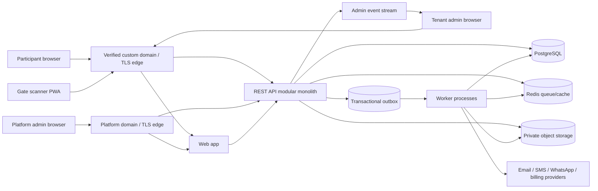

# Event Check-in Platform — Technical Design

**Status:** Step 2 design revised with D-09–D-13; remaining choices listed in Section 16  
**Inputs:** [PRD review](PRD_REVIEW.md), source PRD v1.0, decisions D-01–D-13  
**Companion:** [Database design](DATABASE_DESIGN.md)

## 1. Scope and decision status

The first production release is a multi-tenant, branded SaaS with fully custom tenant domains; one check-in session per event; online-only, server-confirmed QR redemption; self-registration and bulk import; email, SMS, and WhatsApp; CSV/PDF reports; tenant self-service export/deletion; and billing. Gate staff may use personal or organizer-provided phones. Participant personal data is deleted 90 days after an event while non-identifying aggregate statistics remain.

The PRD's offline token cache, offline acceptance, synchronization, first-timestamp-wins, and pending-sync count are **deferred by D-02**. The scanner must show a connection error and must not claim success when the server has not committed a check-in. The venue needs a tested network and backup connection to operate. Offline capability can be designed later, but it cannot be implied by a service worker or an installable app.

FastAPI is the approved backend framework (D-09). Both email and phone are required and individually unique within an event (D-10). The 90-day timer starts at event end, and tenant admins may delete one participant or all participant data for an event (D-11). Section 12 service targets are approved (D-12). Paystack subscriptions in NGN are approved (D-13). Staff authentication and the least-privilege matrix are approved in G-02. The remaining **proposals** include supporting libraries/vendors, QR wire format, exact duplicate correction flow, privacy threshold, and subscription terms. Open decisions are in Section 16.

## 2. Architecture at a glance

Use one deployable API codebase with modules for tenancy, identity, events, registration, tickets, check-in, messaging, reporting, billing, and audit. Workers share domain services but run as separate processes. This keeps transactional check-in and tenant policy in one place while allowing import, sending, and export workloads to scale independently. Do not split into networked microservices at launch.

### Request path and trust boundaries

1. The TLS edge accepts only verified active hostnames. The API resolves the normalized `Host` to a unique tenant domain record. Unknown or inactive hosts fail closed.
2. Public registration obtains tenant context from that verified host and an event slug. Authenticated APIs additionally verify an active tenant membership. A client-supplied tenant ID is never authority.
3. Each tenant database transaction sets a server-derived tenant context. The runtime database role is subject to row-level security and cannot bypass it.
4. Jobs, export keys, cache keys, metrics, and provider callbacks carry explicit tenant and event IDs and revalidate ownership at execution time.
5. Platform administration uses a separate host and privileged API policy. Cross-tenant support access, if added, must be explicit, time-limited, and audited.

This follows PostgreSQL's documented row-security behavior and OWASP's guidance to bind tenant context to verified identity and protect every access path. [PostgreSQL row security](https://www.postgresql.org/docs/current/ddl-rowsecurity.html), [OWASP multi-tenant security](https://cheatsheetseries.owasp.org/cheatsheets/Multi_Tenant_Security_Cheat_Sheet.html).

## 3. Technology choices

| Layer | Proposed launch choice | Why | Viable alternative / change trigger |
|---|---|---|---|
| Web clients | TypeScript, React, Vite, shared component library; scanner is an installable PWA | One web stack across registration, admin, and scanner; small bundles and explicit API separation | Next.js if server rendering or content-heavy public pages become central; native scanner if field tests expose camera/browser gaps |
| Backend | Python, FastAPI REST modular monolith, Pydantic request/response models, SQLAlchemy 2.x, Alembic migrations | Approved framework; clear API schemas, explicit transactions, mature PostgreSQL tooling, and a single Python domain layer shared with workers | Django if an integrated admin/ORM becomes more valuable than the FastAPI choice; changing frameworks would need approval |
| Database | Managed PostgreSQL | Transactions and constraints for single-use redemption, relational reporting, JSONB only for form answers, and row-level isolation | Dedicated database per tenant if contractual isolation or data-residency requirements justify cost |
| Queue and short-lived cache | Redis broker/cache with Celery workers; transactional outbox in PostgreSQL | Independent workers for imports/sends/exports and an outbox to bridge database commit to queue publish | PostgreSQL-backed job runner if measured load and operational simplicity favor fewer services |
| Object storage | Private S3-compatible bucket | Temporary imports, generated tickets and reports with lifecycle deletion and signed downloads | Any managed object store with equivalent access controls and lifecycle rules |
| Edge/custom domains | Managed custom-hostname/TLS service, proposed Cloudflare for SaaS | Automates hostname ownership and certificate state for many tenant domains | Self-managed ingress/ACME if vendor terms or routing requirements make it preferable |
| Email | Provider-independent transactional adapter; local SMTP capture for development; production disabled pending approval | G-02 permits invitation and reset delivery without committing to a vendor | Select a production provider only after deliverability, residency and commercial review |
| SMS/WhatsApp | Provider adapter; evaluate Termii for Nigeria | Matches PRD's Nigeria focus and exposes messaging channels | Direct Meta/another BSP for WhatsApp, or another Nigeria SMS provider, if onboarding, throughput, or delivery is better |
| Billing | Paystack subscriptions in NGN behind a billing adapter | Approved by D-13; provider webhooks and internal usage records stay separate from check-in | Provider change would require a product/operations decision |
| Observability | OpenTelemetry traces, structured logs, metrics, error tracking | Correlates scans and workers across event peaks without vendor lock-in | Managed APM that supports the same signals |

FastAPI runs synchronous path functions in a thread pool, which suits short SQLAlchemy transactions shared with synchronous Celery workers; use asynchronous endpoints only where the full I/O path is nonblocking, such as event streaming. FastAPI points to Celery for work that needs independent processes, and Celery supports Redis as a broker. Use OpenAPI to generate a typed TypeScript API client; keep Python domain logic authoritative. Cloudflare documents separate hostname and certificate validation states; Paystack documents Nigerian recurring-payment methods. These establish feasibility, not a vendor commitment. [FastAPI concurrency](https://fastapi.tiangolo.com/async/), [FastAPI background work](https://fastapi.tiangolo.com/tutorial/background-tasks/), [SQLAlchemy transactions](https://docs.sqlalchemy.org/en/20/orm/session_basics.html), [Celery brokers](https://docs.celeryq.dev/en/stable/getting-started/backends-and-brokers/), [Cloudflare custom hostnames](https://developers.cloudflare.com/cloudflare-for-platforms/cloudflare-for-saas/start/getting-started/), [Paystack subscriptions](https://paystack.com/docs/payments/subscriptions/), [Termii developer docs](https://developer.termii.com/).

Pin supported major versions during implementation after dependency and security review. Keep provider credentials and signing keys in managed secrets, not source control or tenant-editable settings.

## 4. Frontend structure

- **Public registration:** tenant theme and event details; server-defined, versioned form schema; accessible validation; submission state; delivery confirmation. No participant account is required by the approved scope.
- **Tenant admin:** event setup, fields, participants/imports, gate/staff assignments, messaging, live dashboard, reports, privacy actions, billing, and domain/branding settings. Route-level guards improve UX; API policy is authoritative.
- **Platform admin:** tenant provisioning, domain state, plan/usage, billing oversight, and operational status on a separate host.
- **Scanner PWA:** camera preview via `getUserMedia()`, continuous decode with a bounded rate, clear success/duplicate/invalid/network states, event/gate identity, recent local UI history, and manual retry. Do not cache participant records or accepted QR tokens. Clear a captured token from memory after response and do not put it in URLs, logs, analytics, or browser storage.

Camera access requires HTTPS/secure context and user permission. A PWA can be installable without implementing offline check-in. Device and browser support must be field-tested on representative low-end phones. [MDN camera API](https://developer.mozilla.org/en-US/docs/Web/API/MediaDevices/getUserMedia), [MDN PWA installation](https://developer.mozilla.org/en-US/docs/Web/Progressive_web_apps/Guides/Making_PWAs_installable).

Serve `/api` from the same tenant origin so host-only secure cookies and camera permissions have predictable behavior across custom domains. Service worker caching is limited to static assets and a non-sensitive offline error screen; API responses and credentials are network-only. The scanner should distinguish “no response” from a server-confirmed rejection. No optimistic green confirmation.

## 5. Backend modules and API contracts

Version APIs under `/api/v1`. Use REST and FastAPI-generated OpenAPI schemas, with contract review before generating the frontend client. Every mutation returns a request ID; validation errors use a stable machine code and safe human message. Cursor pagination and server-side filtering apply to participant, scan, and message lists. Keep one SQLAlchemy session and explicit transaction boundary per request/job; set tenant context within that transaction before tenant queries, then close the session. Synchronous database endpoints run as normal `def` path operations so blocking I/O is off the event loop.

| Module | Main responsibilities | Representative routes |
|---|---|---|
| Tenant/domain | Provision tenant; validate hostname ownership and TLS readiness; branding | `POST /platform/tenants`, `POST /platform/tenants/{id}/domains`, `GET /tenant/branding` |
| Identity/access | Invite, login, reset, MFA for privileged users, membership and gate assignment | `POST /auth/login`, `POST /tenant/invitations`, `POST /events/{id}/gates/{gateId}/staff` |
| Event/registration | Event state; form schema; public registration; participant corrections and deletion | `POST /events`, `POST /public/events/{slug}/registrations`, `GET /events/{id}/registrations` |
| Import | Upload, preview, confirm, progress, row errors | `POST /events/{id}/imports`, `GET /imports/{id}`, `POST /imports/{id}/commit` |
| Ticket | Issue/reissue, resend, revoke | `POST /registrations/{id}/ticket/resend`, `POST /registrations/{id}/ticket/reissue` |
| Check-in | Online atomic redeem and attempt history | `POST /events/{id}/scan-attempts`, `GET /events/{id}/check-ins` |
| Dashboard | Snapshot and live changes | `GET /events/{id}/dashboard`, `GET /events/{id}/stream` (SSE) |
| Messaging | Segment preview, campaign approval/send, delivery callbacks | `POST /events/{id}/campaigns`, `POST /campaigns/{id}/send`, `POST /webhooks/messaging/{provider}` |
| Reporting/privacy | CSV/PDF jobs, signed download, participant export/delete, retention status | `POST /events/{id}/exports`, `GET /exports/{id}`, `POST /events/{id}/privacy/purge` |
| Billing | Plan/usage, payment initiation, webhook reconciliation | `GET /tenant/billing`, `POST /tenant/billing/checkout`, `POST /webhooks/billing/{provider}` |

These routes are proposed contracts, not a complete endpoint list. Public APIs are rate-limited by IP and event; admin/scanner APIs by authenticated principal, tenant, and event. Webhooks verify provider signatures, replay windows where supported, and event IDs before processing.

## 6. Authentication and authorization

**Approved identity policy (G-02):** first-party Argon2id staff passwords, invitation-only onboarding, opaque server-managed sessions in `Secure`, `HttpOnly`, host-only cookies with CSRF defense, and TOTP/recovery-code MFA for effective privileged permissions. Session timeouts, invitation/reset lifetimes, and the least-privilege role matrix are normative in [G-02](DECISIONS/G-02_STAFF_IDENTITY.md). A device ID is for operations/audit, not authentication. Login and session refresh require connectivity; revocation and permission changes take effect on the next request. Earlier provider and session values in this section were proposals and are superseded by G-02.

| Capability | Platform admin | Tenant admin | Gate staff | Participant |
|---|---:|---:|---:|---:|
| Tenant/domain/billing management | Platform scope | Own tenant settings/billing | — | — |
| Event/form/registration management | Explicit support grant only | Own tenant | — | Public self-registration |
| Scan/redeem ticket | — | Optional only if assigned as staff | Assigned event/gate | — |
| Participant detail/report access | Explicit support grant only | Own tenant | — | Own submission only if retrieval later approved |
| Messaging | — | Own tenant | — | Receives according to channel/legal basis |

Authorization checks combine session, active membership, effective permissions, tenant, event status, and gate assignment. Platform admins do not automatically browse tenant participant data. Every privileged action is audited. G-02 approves the identity and session policy; the compromised-password dataset and production email provider remain activation decisions.

## 7. QR issuance and online verification

**Proposed wire format:** `v1.<tenant-id>.<event-id>.<ticket-id>.<random-nonce>.<key-version>.<HMAC-SHA256>`, encoded as a QR. IDs are random UUIDs; nonce has at least 128 bits of CSPRNG entropy. The MAC covers all preceding fields with a server-held, versioned secret. The QR contains no name, email, phone, custom answers, or URLs. Signing proves server issuance; it does not make a copied QR non-transferable. TLS protects it in transit, and the stored resend copy is encrypted at rest. Never ship verification secrets to scanners.

Issue one active ticket per registration. `resend` sends the current active ticket again from an encrypted stored copy; `reissue` revokes the current ticket and creates a new one. Both actions are audit events. Ticket state and event status, not the signature alone, decide entry.

### Scan transaction

1. Scanner submits the QR body, event/gate/device IDs, and a client-generated idempotency key over HTTPS. The server derives tenant and staff scope from host/session and applies request-size/rate limits.
2. Verify format, MAC, event/tenant binding, and active event window. Fetch ticket and compare a server-side digest of the full credential. Never log the raw QR.
3. In one database transaction, insert or find the idempotency record, conditionally move the ticket from `active` to `used`, insert a check-in and scan attempt, and update counters/outbox. PostgreSQL row locking/conditional update makes concurrent gate requests yield one success.
4. Return a definitive `accepted`, `duplicate`, `invalid`, `revoked`, or `event_closed` result with server time. Gate staff see only result and a neutral help instruction; tenant admins can inspect authorized scan detail. A retry with the same idempotency key returns the original result.

The server does not rely on scanner timestamps for ordering. If two gates send the same credential concurrently with different idempotency keys, the first committed ticket transition wins; the other is logged as duplicate. A replay after a successful response remains duplicate except when it is the exact same idempotent request. If the scanner times out, it retries with the same key and displays “Verifying…” or “Could not confirm”; it never shows success from a timeout.

**QR-only risk accepted by D-03:** the first person to present a valid copied ticket can enter. “Non-transferable” in the PRD is interpreted as no second successful redemption while online, not identity proof. Avoid exposing the first gate/time to gate staff unless explicitly approved.

## 8. Online-only scanner and future offline design

Launch has **no local token bundle, queued scans, local check-in decisions, or sync endpoint**. A device can keep its shell installed, but a network interruption blocks check-in. The admin dashboard shows confirmed server counts plus scanner connection/last-heartbeat status; it does not claim to know unseen offline attempts.

For a later offline release, the current data model retains event/gate/device and server receipt fields so a new `provisional_scan` and `sync_batch` model can be added. That release needs a separate product decision on provisional admission, stale/revoked tickets, device trust, clock disputes, and data cached on personal phones. It must not silently resurrect PRD first-timestamp-wins.

| Future option | How it works | Main trade-off |
|---|---|---|
| Device-local provisional acceptance | Authorized device caches a limited, encrypted event manifest; scans are queued with unique attempt IDs and local sequence numbers; server reconciles on reconnect. | Disconnected gates can each admit a copy of the same QR. Client timestamps cannot prove true order. |
| Venue-local check-in server | Scanners connect to a local server over venue Wi-Fi; that server performs the atomic single-use decision and syncs centrally later. | Preserves one decision point within the venue but adds on-site hardware/network operations and split-brain risk across sites. |
| Gate-partitioned tickets | Each ticket is assigned to a gate whose local device/server can redeem it offline. | Restricts attendee movement and creates operational reassignment problems. |

If provisional device scanning is ever approved, a sync request should carry a stable device/session ID, monotonically increasing local sequence, unique attempt IDs, and an immutable batch ID. The server should acknowledge each attempt separately and store both provisional and final results. Retries must be idempotent. Server receipt/commit order could define a deterministic winner, but that is a *new* product policy and does not establish which person actually arrived first. Offline cache expiry, revocation lag, secure wipe, and BYOD data exposure would require a separate threat model and field test before release.

## 9. Registration, import, and background work

- Self-registration requires each attendee's own email and phone, validates the published schema, normalizes email/phone, checks both event-scoped unique constraints, records source/time/consent evidence, creates a registration and ticket, and places a delivery request in the transactional outbox. A duplicate email or duplicate phone returns a field-specific error; it never merges records automatically. Response does not depend on provider delivery.
- Bulk upload streams CSV/XLSX from private object storage through a Celery worker, checks file type/size, detects formula injection risks, validates rows, and returns preview/error files. Commit is explicit and idempotent. Each accepted row uses the same registration service as self-registration and rejects repeated normalized email or phone within the file or existing event records. Correction/replacement behavior remains open.
- Outbox dispatcher publishes jobs to Celery; workers handle import batches, ticket mail, campaigns, exports, domain provisioning, billing callbacks, and retention. Jobs carry only IDs, re-fetch data under tenant context, use bounded retries/backoff, and move permanent failures to an inspectable failed-job state. Workers are idempotent because delivery and retries can repeat.
- Provider delivery callbacks reconcile message state by provider message ID. At-least-once callbacks and jobs must be idempotent. A sent count is not a delivered count.
- Campaign sends require a computed recipient preview, suppression/consent filtering, and a recorded admin confirmation. WhatsApp templates and onboarding are provider/policy dependencies. The current WhatsApp policy requires approved templates for business-initiated conversations. [WhatsApp Business policy](https://whatsappbusiness.com/policy/).

## 10. Billing and custom domains

Billing is in launch scope under D-07, with **Paystack subscriptions in NGN** approved by D-13. Plan prices, billing interval, trials, SMS/WhatsApp add-on charging, tax treatment, and suspension rules remain open. The architecture separates **usage metering** (immutable events such as registrations and paid-channel sends) from **subscription/payment state**. A Paystack adapter handles plan/customer/subscription calls and verifies signed webhooks. Provider callbacks are idempotent by event ID. A reported payment never changes tenant entitlement until the callback is verified and the billing state transition is committed. Whether nonpayment blocks future event creation is open; scanning an already live event should remain available under the proposed operational policy.

Domain onboarding: tenant admin proposes a hostname; platform checks uniqueness and ownership; tenant configures validation/DNS; certificate and hostname independently reach active state; a smoke check confirms routing; only then can it become the primary domain. Failed or removed domains never resolve to another tenant. The platform-owned subdomain remains a recovery route unless product policy forbids it. Sender-domain verification is a separate workflow from web-domain verification. Cloudflare documents these independent active states. [Cloudflare hostname validation](https://developers.cloudflare.com/cloudflare-for-platforms/cloudflare-for-saas/domain-support/hostname-validation/).

## 11. Data lifecycle and privacy

The tenant is expected to act as event data controller and the platform as processor, subject to legal review and contract terms. The system records purpose/legal basis and channel-specific consent where applicable; ticket delivery and marketing/event campaigns are separate categories. Tenant admins can request participant export and deletion through permissioned workflows. Deletion revokes affected tickets and purges direct identifiers and linked message/scan details while preserving only aggregates that cannot be tied back to a person.

**Approved 90-day anchor:** `event.ends_at` in UTC. A scheduled purge runs at `ends_at + 90 days`, with daily catch-up and an admin-visible status. Tenant admins may request one-person deletion or whole-event participant-data deletion before that deadline. Before purge, compute and freeze anonymous totals by event/gate/hour and campaign channel. Purge participant rows/answers, ticket secrets, linked scan details, delivery logs, personal exports, and uploaded source files. The old participant-level reports become unavailable; only aggregate reports remain. Short-lived backups may retain encrypted data until their lifecycle expiry, with restricted restoration and re-purge procedures. A legal hold is not assumed and would require explicit policy.

The Nigeria Data Protection Commission publishes the NDP Act and guidance on data subject rights and retention. This design is a technical proposal, not a legal compliance determination. [NDPC NDP Act](https://ndpc.gov.ng/download/nigeria-data-protection-act-2023), [NDPC guidance](https://ndpc.gov.ng/wp-content/uploads/2025/03/NDP-ACT-GAID-2025-MARCH-20TH.pdf).

## 12. Proposed service objectives and sizing assumptions

These values were proposed in Step 2 and approved by D-12. They are the launch acceptance and capacity-planning baseline; the test envelope includes explicit headroom above the PRD's minimum event size.

| Measure | Approved launch target / test envelope | Notes |
|---|---|---|
| Event size | 15,000 registrations; test 30,000 | PRD says 10,000–15,000+; approved test headroom. |
| Gate concurrency | 50 active scanners; burst 25 scan requests/s for 10 minutes | Approved sizing envelope; validate with event operations. |
| Scan confirmation | API p95 ≤ 500 ms and p99 ≤ 1 s under test load; UI confirmation p95 ≤ 2 s on supported network | Camera acquisition and poor mobile network are separately measured. |
| Dashboard freshness | p95 ≤ 5 s from committed scan to connected admin view | Snapshot refresh is fallback if SSE disconnects. |
| Bulk import | 15,000-row CSV/XLSX preview ≤ 10 min under normal provider-free load | Email dispatch has separate provider rate limits. |
| Event-window availability | 99.95% across scheduled active check-in windows | Operational measurement method and budget need definition. |
| Recovery | RPO ≤ 5 min; RTO ≤ 30 min for regional app/database failure | Requires tested backups and managed failover. |
| Retention | Participant personal data purged at `ends_at + 90 days`; daily purge catches missed runs within 24 h | Anchor approved by D-11; backup expiry and restore procedure remain implementation controls to define. |

Run load tests with concurrent gates, duplicate storms, a 15,000-row import, simultaneous campaign sends, and large exports. Do not put bulk work on the scan request path. Size database connections and provider throughput against these tests before launch.

## 13. Deployment, resilience, and monitoring

Reference deployment: managed containers for web/API/workers across two availability zones; managed PostgreSQL with automated backups and failover; managed Redis; private object storage; TLS edge/custom-hostname service; secrets manager; infrastructure as code. Separate staging and production accounts/projects. Choose hosting region only after tenant data-location and vendor review; do not assume a Nigeria data-center requirement that the PRD does not state.

The check-in API is stateless and horizontally scalable; PostgreSQL is the authoritative write path. Redis failure delays jobs and live fan-out but must not make successful QR redemption impossible. Dashboard can fall back from SSE to polling. Rate limits and queue concurrency protect the scan path during email/export spikes. Deployments use rolling or blue/green release with database expand/migrate/contract sequencing; pause nonessential bulk work during critical event windows if needed.

Track scan request rate, p95/p99 latency, error/timeout rate, accepted/duplicate/invalid counts, database saturation, queue lag/failures, provider rejection, domain/TLS status, scanner heartbeat staleness, purge failures, and cross-tenant denial events. Structured logs include request, tenant, event, gate, and job IDs but never raw QR or participant fields. Alerts page the on-call operator during active events; a pre-event readiness check verifies domain, staff accounts, gate assignment, connectivity, and representative scan flow.

## 14. Security and quality strategy

- Threat model public registration abuse, QR theft/replay, cross-tenant reads/writes, staff account compromise, upload abuse, provider webhook spoofing, export leakage, and deletion failures.
- Enforce authorization at every endpoint and in domain services; use RLS, composite tenant foreign keys, private object storage, signed short-lived downloads, and tenant-aware cache/queue keys as defense in depth.
- Use HTTPS, HSTS, secure cookies/CSRF protection, MFA for privileged roles, secret rotation, least-privilege provider keys, dependency and container scanning, and audit logs for admin actions.
- Validate CSV/XLSX content and limit resources; neutralize spreadsheet formula cells in CSV exports. Use server-side escaping for branding and custom-field labels. [OWASP file upload](https://cheatsheetseries.owasp.org/cheatsheets/File_Upload_Cheat_Sheet.html), [OWASP REST security](https://cheatsheetseries.owasp.org/cheatsheets/REST_Security_Cheat_Sheet.html).
- Test at several levels: pure domain rules; database concurrency/idempotency and RLS; API role/tenant matrices; provider and webhook contracts; import/export golden files; browser camera/permission/error states; accessibility; load/soak; backup restore; 90-day purge including exports and storage.
- A release gate should demonstrate that two concurrent scans produce exactly one successful check-in and that no tenant can retrieve another tenant's records by changing host, IDs, filters, or job payloads.

## 15. Requirement traceability

| PRD ID | Launch design location / disposition |
|---|---|
| F-01, F-02, N-03, N-08 | Sections 2, 5, 10, 13; database tenant/domain/event constraints |
| F-03, F-05 | Sections 7 and 9; ticket issue, resend, signing, delivery |
| F-04 | Sections 5 and 9; registration/import |
| F-06, F-08, N-04 | Deferred by D-02; Section 8 records future design boundary |
| F-07 | Sections 4 and 6; assigned gate-staff sessions |
| F-09 | Sections 4, 5, 8, 12; confirmed live dashboard, no pending-sync counts at launch |
| F-10 | Sections 3, 9, 10; multi-channel messaging and billing |
| F-11 | Sections 5, 9, 11; CSV/PDF and 90-day detail expiry |
| F-12 | Sections 7 and 11; every online attempt logged until privacy purge |
| F-13, F-14 | Sections 4–6 and 10; platform/tenant admin capabilities |
| N-01 | Sections 2, 6, 7, 11, 14; security and privacy controls |
| N-02, N-05, N-06, N-07 | Sections 4, 11–14; proposed targets and validation |

## 16. Decisions still requiring approval

These affect specific implementation contracts. The rest of the architecture can be reviewed now.

1. **Subscription terms:** Paystack and NGN are approved (D-13). Decide plan prices, monthly/annual interval, trials, included events/attendees, SMS/WhatsApp add-on charging, tax treatment, and nonpayment behavior. My recommendation is never to interrupt an active event for billing state.
2. **Registration correction:** email and phone are each required and unique per event (D-10). Decide how an attendee corrects a mistyped contact, how an admin replaces a cancelled registration, and whether on-site registration is allowed. No automatic merge is proposed.
3. **Staff access and scanner feedback:** whether to show only status or also a short attendee label; password/MFA policy for gate staff; supported browsers and minimum device profile. D-03 does not require identity display.
4. **Deletion execution:** D-11 approves the event-end anchor and both person/event self-service scopes. Decide whether an admin-requested deletion is immediate or queued with a short reversal window, and how pre-event deletion affects displayed counts.
5. **Messaging:** which sends are transactional vs promotional; consent/opt-out rules, template ownership, sender verification, and provider onboarding. Provider and legal review must precede production sends.
6. **Data location and vendors:** choose deployment region and approve cross-border processing/provider list after privacy review.
7. **QR confidentiality:** approve a signed, non-PII QR payload with encrypted storage and TLS transport as the interpretation of the PRD's “signed/encrypted” wording. Encrypting the QR payload itself is possible, but does not prevent copying or improve the online single-use guarantee.

## Reference documentation

The linked official documentation and authority sources above were checked for feasibility and current behavior while drafting this proposal. They do not replace decisions in this document or a project-specific legal and vendor assessment.
